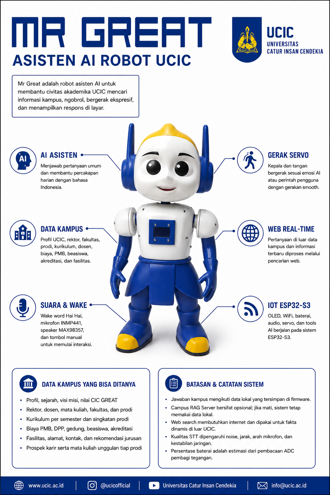

# Firmware Mr Great ESP32-S3

Firmware asisten suara bahasa Indonesia untuk robot mini Mr Great berbasis
ESP32-S3. Fokusnya pengetahuan kampus UCIC dan Kota Cirebon, pencarian web,
pemutar musik, layar OLED, serta servo kepala dan tangan yang bergerak
mengikuti emosi maupun perintah pengguna.

**Versi V1.1.** Migrasi penuh ke arsitektur firmware terbaru. Seluruh
kustomisasi Mr Great dari versi sebelumnya sudah dipindahkan, dan sejumlah
masalah lama diperbaiki di sepanjang jalan.

## Poster dan Dokumentasi Fitur

| | |
|:---:|:---:|
| <br>Poster Mr Great | <br>Dokumentasi fitur |

## Pratinjau Perangkat

| | |
|:---:|:---:|
|  |  |
|  |  |
|  |  |
|  | |

## Fitur Utama

- Kata bangun lokal `hai hai` untuk memanggil Mr Great.
- Audio masuk lewat INMP441 dan audio keluar lewat MAX98357.
- Layar OLED I2C 0,96 inci untuk status, jaringan, baterai, dan respons.
- Ekspresi wajah memakai gambar emoji kustom 64 piksel, sedangkan ikon bukan
  wajah tetap memakai font ikon bawaan.
- Servo kepala, tangan kanan, dan tangan kiri dengan perintah suara serta MCP.
- Gerakan emosi otomatis yang mengalah pada perintah manual pengguna.
- Tombol taktil empat kaki di `GPIO1` sebagai tombol manual.
- Pemutar musik dengan nada tunggu selama lagu disiapkan.
- Pencarian web dengan prioritas berita Cirebon.
- Bahasa firmware dibatasi ke Indonesia agar partisi aset tetap ringan.

## Prioritas Jawaban AI

1. Data kampus dan Kota Cirebon di `main/campus_data.cc`.
2. Server RAG Mr Great bila `CONFIG_MRGREAT_SERVER_URL` diisi.
3. Pencarian web di `main/web_search.cc` untuk data terbaru.
4. Pengetahuan bawaan model untuk pertanyaan umum.

## Pin Perangkat

| Komponen | Koneksi ESP32-S3 |
|---|---|
| OLED SDA | `GPIO10` |
| OLED SCL | `GPIO9` |
| INMP441 WS | `GPIO4` |
| INMP441 SCK | `GPIO5` |
| INMP441 SD | `GPIO6` |
| MAX98357 DIN | `GPIO7` |
| MAX98357 BCLK | `GPIO15` |
| MAX98357 LRC | `GPIO16` |
| Servo kepala | `GPIO17` |
| Servo tangan kanan | `GPIO38` |
| Servo tangan kiri | `GPIO39` |
| Tombol manual | `GPIO1` ke GND |
| Pembacaan baterai | `GPIO2` lewat pembagi tegangan |
| USB native D- | `GPIO19` |
| USB native D+ | `GPIO20` |

## Catatan Tombol Manual

Tombol memakai `GPIO1` ke GND dengan pull-up internal. Pada tactile empat kaki,
pilih dua kaki yang berbeda sisi, biasanya satu kaki kiri dan satu kaki kanan
atau diagonal. Jangan memakai kiri atas dengan kiri bawah, atau kanan atas
dengan kanan bawah, bila kedua kaki itu sudah tersambung permanen, karena
tekanan tombol tidak akan mengubah sinyal yang dibaca firmware.

Tombol ini bukan tombol BOOT untuk mode download. Untuk masuk mode download,
tahan tombol BOOT di `GPIO0` saat reset.

## Catatan Baterai

Pembagi tegangan yang dipakai:

- resistor atas `100 kOhm` dari titik baterai ke node ADC
- resistor bawah `100 kOhm` dari node ADC ke GND
- kapasitor `100 nF` dari node ADC ke GND
- node ADC masuk ke `GPIO2`

Titik atas pembagi harus diambil dari sisi baterai atau keluaran TP4056, bukan
dari keluaran boost 5V MT3608. Bila diambil dari keluaran boost, yang terbaca
adalah tegangan regulator 5V, bukan tegangan baterai yang sebenarnya.

Pembacaan ADC dihentikan sementara saat servo bergerak, karena step-up dan SG90
sama-sama menimbulkan riak pada pembagi tegangan sehingga nilai yang terbaca
saat itu jauh lebih rendah daripada tegangan sebenarnya.

## Catatan USB Type-C

Pin `V` dan `G` pada USB breakout dipakai untuk jalur charging ke TP4056. Pin
`D+` dan `D-` bukan jalur daya, jadi tidak membuat baterai terisi lebih cepat
dan tidak menyalakan ESP32.

Untuk memakai USB data native, sambungkan `D+` ke `GPIO20`, `D-` ke `GPIO19`,
dan pastikan ground USB satu jalur dengan ground sistem. ESP32-S3 tetap harus
mendapat daya dari rangkaian baterai atau jalur 5V yang aman.

## Build, Flash, dan Monitor

```powershell
idf.py set-target esp32s3
idf.py build
idf.py -p COM3 flash
idf.py -p COM3 monitor
```

Bila flash serial kurang stabil, turunkan baud rate:

```powershell
idf.py -p COM3 -b 115200 flash
```

## Dokumentasi Terkait

- [Panduan servo dan tombol](docs/mrgreat-servo.md)
- [Pemutar musik](docs/mrgreat-music.md)
- [RAG data kampus dan Cirebon](docs/mrgreat-rag.md)
- [Server Mr Great](docs/mrgreat-server.md)
- [Build dan pemecahan masalah](docs/mrgreat-build.md)
- [Lampu indikator](docs/mrgreat-led.md)
- [Layar dan emoji kustom](docs/mrgreat-display.md)
- [Jalur audio dan perbaikan suara mendem](docs/mrgreat-audio.md)
- [Konfigurasi BluFi](docs/blufi.md)
- [Campus RAG Server](docs/campus-rag-server.md)
- [Panduan gaya kode](docs/code_style.md)
- [Panduan papan kustom](docs/custom-board.md)
- [Protokol MCP](docs/mcp-protocol.md)
- [Penggunaan MCP](docs/mcp-usage.md)
- [Protokol MQTT dan UDP](docs/mqtt-udp.md)
- [Daftar validasi perangkat keras](docs/production-hardware-checklist.md)
- [Protokol WebSocket](docs/websocket.md)

## Versi

Proyek ini adalah **V1.1**. Baris berikut muncul paling awal di monitor:

```text
I main: Mr Great Robot V1.1
```

Angka `App version` yang muncul tepat sesudahnya adalah versi firmware hulu,
bukan versi proyek ini, dan sengaja dibiarkan apa adanya. Angka itu dipakai
server OTA untuk membandingkan versi, dan pembaruan berjalan otomatis saat
boot. Menurunkannya membuat server menganggap ada versi yang lebih baru,
sehingga seluruh kustomisasi di sini akan tertimpa firmware hulu.

## Catatan Rilis

Berkas di `managed_components/` adalah dependensi pihak ketiga dan tidak perlu
diubah untuk kustomisasi Mr Great. Emoji kustom sengaja ditaruh di
`components/mrgreat_emoji/`, bukan menimpa komponen font bawaan, supaya
pembaruan komponen dari hulu tidak menghapusnya.
